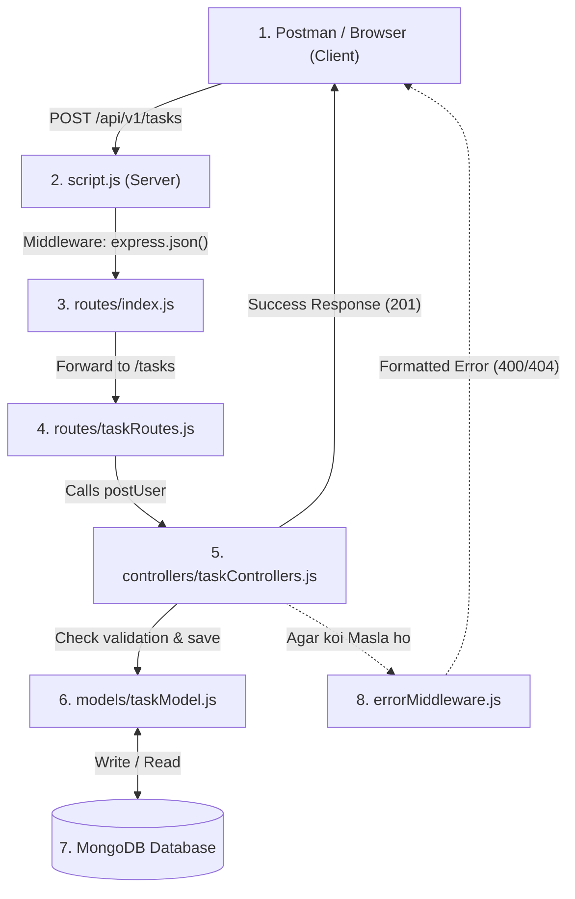

### 1. Restaurant Wali Asaan Misaal (Real-Life Analogy)

Poore project ko ek **Restaurant** samjhein:

| Code Ka Hissa | Restaurant me Kaun Hai? | Asal Kaam |
| :--- | :--- | :--- |
| **User / Postman** | **Customer** | Jo order deta hai (Request bhejta hai). |
| [`script.js`](file:///c:/backend/script.js) | **Restaurant Ka Main Gate** | Jahan customer pehle dakhil hota hai aur app start hoti hai. |
| [`routes/`](file:///c:/backend/routes) | **Receptionist / Menu Card** | Customer ki request dekh kar sahi counter par bhejta hai. |
| [`controllers/`](file:///c:/backend/controllers/taskControllers.js) | **Waiter / Chef-Manager** | Request par sochna, check karna aur data lana/bhejna. |
| [`models/`](file:///c:/backend/models/taskModel.js) | **Recipe Book / Rules** | Batata hai ke dish (data) me kya kya hona lazmi hai. |
| **MongoDB Database** | **Kitchen Ka Store-Room** | Jahan saara data asal me store hota hai. |
| [`middleware/`](file:///c:/backend/middleware) | **Security Guard** | Raste me checking karna ya garbar hone par sambhalna. |

---

### 2. Yeh Folders Kyu Banaye Gaye? (Har Folder Ka Maqsad)

```text
backend/
├── script.js             <-- Main Engine (Start point)
├── routes/               <-- Traffic Police (URLs ki routing)
│   ├── index.js
│   └── taskRoutes.js
├── controllers/          <-- Brain / Dimagh (Logic)
│   └── taskControllers.js
├── models/               <-- Structure / Shakal (Database Schema)
│   └── taskModel.js
├── middleware/           <-- Chowkidar (Errors aur checks)
│   ├── catchAsync.js
│   └── errorMiddleware.js
└── utils/                <-- Helper Tools (Madadgar tools)
    ├── AppError.js
    └── httpStatus.js
```

#### ① `script.js` (Main Entry Point)
* **Kyu hai?** Yeh server ko start karta hai, database connect karta hai, aur global rules set karta hai.
* Yeh direct data par koi kaam nahi karta, sirf sabko aapas me jodta hai.

#### ② `routes/` (Traffic Controller)
* **Kyu hai?** Pehle agar 50 endpoints hote toh `app.get()`, `app.post()` se file bhar jati thi.
* Ab:
  * [`routes/index.js`](file:///c:/backend/routes/index.js) kehta hai: `api/v1/tasks` se related jo bhi aaye, usay `taskRoutes` ke hawale kardo.
  * [`routes/taskRoutes.js`](file:///c:/backend/routes/taskRoutes.js) kehta hai: 
    * `GET /` aaye to `getAllTask` bulao.
    * `POST /` aaye to `postUser` bulao.
    * `DELETE /:id` aaye to `deleteUser` bulao.

#### ③ `controllers/` (Dimagh / Business Logic)
* **Kyu hai?** Routing file ka kaam sochna nahi hota, uska kaam sirf rasta dikhana hota hai.
* Sochne ka saara kaam [`controllers/taskControllers.js`](file:///c:/backend/controllers/taskControllers.js) karta hai:
  * Kya user ne naam bheja hai?
  * Agar nahi bheja toh error phenko.
  * Agar bheja hai toh Database me save karwao.
  * Wapas response bana kar client ko bhejo.

#### ④ `models/` (Data Ki Shakal / Rules)
* **Kyu hai?** Database me kachra data na jaye.
* [`models/taskModel.js`](file:///c:/backend/models/taskModel.js) me likha hai:
  * `name` lazmi (required) hona chahiye.
  * `designation` sirf in 3 me se ek ho: `"Software Engineer"`, `"Data Scientist"`, `"Project Manager"`.

#### ⑤ `middleware/` aur `utils/` (Safety & Cleanliness)
* **[`catchAsync.js`](file:///c:/backend/middleware/catchAsync.js):** Har function me baar baar `try { ... } catch (error) { ... }` likhne se jaan chhudata hai. Agar koi bhi error aye, ye khud pakad kar error middleware ko de deta hai.
* **[`AppError.js`](file:///c:/backend/utils/AppError.js):** Custom error banane ke liye tool (e.g., `"User Not Found"`, code: 404).
* **[`errorMiddleware.js`](file:///c:/backend/middleware/errorMiddleware.js):** Poore project ka central ambulance/hospital. Koi bhi error aaye, response yahi se format ho kar user ko jata hai.
* **[`httpStatus.js`](file:///c:/backend/utils/httpStatus.js):** Status codes ko naam deta hai taake `200`, `404`, `500` yaad na rakhne padein (`HttpStatus.OK`, `HttpStatus.NOT_FOUND`).

---

### 3. Data Kaha Se Kaha Flow Hota Hai? (Step-by-Step)

Maan lijiye Postman se ek Request aayi:
> **`POST http://localhost:3002/api/v1/tasks`**
> Body: `{ "name": "Ali", "designation": "Software Engineer" }`

Ran list all files in codebase · Exited with code 1
Ran list non-node_modules files
Analyzed script.js:L1-60
Analyzed index.js:L1-7
Analyzed taskRoutes.js:L1-13
Analyzed taskControllers.js:L1-100
Analyzed taskModel.js:L1-25
Analyzed catchAsync.js:L1-7
Analyzed errorMiddleware.js:L1-35
Analyzed AppError.js:L1-11
Analyzed httpStatus.js:L1-11

Fikar bilkul na karein! Is poore architecture ko hum bilkul basic aur desi andaaz me samjhenge.

Pehle code ek hi file me khichdi bana hua tha. Ab isko **MVC (Model - View - Controller)** pattern par divide kar diya gaya hai taake har file ka sirf **ek specific kaam** ho.

---

### 1. Restaurant Wali Asaan Misaal (Real-Life Analogy)

Poore project ko ek **Restaurant** samjhein:

| Code Ka Hissa | Restaurant me Kaun Hai? | Asal Kaam |
| :--- | :--- | :--- |
| **User / Postman** | **Customer** | Jo order deta hai (Request bhejta hai). |
| [`script.js`](file:///c:/backend/script.js) | **Restaurant Ka Main Gate** | Jahan customer pehle dakhil hota hai aur app start hoti hai. |
| [`routes/`](file:///c:/backend/routes) | **Receptionist / Menu Card** | Customer ki request dekh kar sahi counter par bhejta hai. |
| [`controllers/`](file:///c:/backend/controllers/taskControllers.js) | **Waiter / Chef-Manager** | Request par sochna, check karna aur data lana/bhejna. |
| [`models/`](file:///c:/backend/models/taskModel.js) | **Recipe Book / Rules** | Batata hai ke dish (data) me kya kya hona lazmi hai. |
| **MongoDB Database** | **Kitchen Ka Store-Room** | Jahan saara data asal me store hota hai. |
| [`middleware/`](file:///c:/backend/middleware) | **Security Guard** | Raste me checking karna ya garbar hone par sambhalna. |

---

### 2. Yeh Folders Kyu Banaye Gaye? (Har Folder Ka Maqsad)

```text
backend/
├── script.js             <-- Main Engine (Start point)
├── routes/               <-- Traffic Police (URLs ki routing)
│   ├── index.js
│   └── taskRoutes.js
├── controllers/          <-- Brain / Dimagh (Logic)
│   └── taskControllers.js
├── models/               <-- Structure / Shakal (Database Schema)
│   └── taskModel.js
├── middleware/           <-- Chowkidar (Errors aur checks)
│   ├── catchAsync.js
│   └── errorMiddleware.js
└── utils/                <-- Helper Tools (Madadgar tools)
    ├── AppError.js
    └── httpStatus.js
```

#### ① `script.js` (Main Entry Point)
* **Kyu hai?** Yeh server ko start karta hai, database connect karta hai, aur global rules set karta hai.
* Yeh direct data par koi kaam nahi karta, sirf sabko aapas me jodta hai.

#### ② `routes/` (Traffic Controller)
* **Kyu hai?** Pehle agar 50 endpoints hote toh `app.get()`, `app.post()` se file bhar jati thi.
* Ab:
  * [`routes/index.js`](file:///c:/backend/routes/index.js) kehta hai: `api/v1/tasks` se related jo bhi aaye, usay `taskRoutes` ke hawale kardo.
  * [`routes/taskRoutes.js`](file:///c:/backend/routes/taskRoutes.js) kehta hai: 
    * `GET /` aaye to `getAllTask` bulao.
    * `POST /` aaye to `postUser` bulao.
    * `DELETE /:id` aaye to `deleteUser` bulao.

#### ③ `controllers/` (Dimagh / Business Logic)
* **Kyu hai?** Routing file ka kaam sochna nahi hota, uska kaam sirf rasta dikhana hota hai.
* Sochne ka saara kaam [`controllers/taskControllers.js`](file:///c:/backend/controllers/taskControllers.js) karta hai:
  * Kya user ne naam bheja hai?
  * Agar nahi bheja toh error phenko.
  * Agar bheja hai toh Database me save karwao.
  * Wapas response bana kar client ko bhejo.

#### ④ `models/` (Data Ki Shakal / Rules)
* **Kyu hai?** Database me kachra data na jaye.
* [`models/taskModel.js`](file:///c:/backend/models/taskModel.js) me likha hai:
  * `name` lazmi (required) hona chahiye.
  * `designation` sirf in 3 me se ek ho: `"Software Engineer"`, `"Data Scientist"`, `"Project Manager"`.

#### ⑤ `middleware/` aur `utils/` (Safety & Cleanliness)
* **[`catchAsync.js`](file:///c:/backend/middleware/catchAsync.js):** Har function me baar baar `try { ... } catch (error) { ... }` likhne se jaan chhudata hai. Agar koi bhi error aye, ye khud pakad kar error middleware ko de deta hai.
* **[`AppError.js`](file:///c:/backend/utils/AppError.js):** Custom error banane ke liye tool (e.g., `"User Not Found"`, code: 404).
* **[`errorMiddleware.js`](file:///c:/backend/middleware/errorMiddleware.js):** Poore project ka central ambulance/hospital. Koi bhi error aaye, response yahi se format ho kar user ko jata hai.
* **[`httpStatus.js`](file:///c:/backend/utils/httpStatus.js):** Status codes ko naam deta hai taake `200`, `404`, `500` yaad na rakhne padein (`HttpStatus.OK`, `HttpStatus.NOT_FOUND`).

---

### 3. Data Kaha Se Kaha Flow Hota Hai? (Step-by-Step)

Maan lijiye Postman se ek Request aayi:
> **`POST http://localhost:3002/api/v1/tasks`**
> Body: `{ "name": "Ali", "designation": "Software Engineer" }`



#### Step 1: Request Dakhil Hui
Request aayi `script.js` ke paas.
`app.use(express.json())` ne incoming JSON body ko parse kiya taake code usay samajh sake.

#### Step 2: Rasta Talaash Hua (Routes)
* `script.js` ne dekha URL shuru ho raha hai `/api/v1` se, usne bhej diya [`routes/index.js`](file:///c:/backend/routes/index.js) ko.
* `routes/index.js` ne dekha aage `/tasks` hai, usne bhej diya [`routes/taskRoutes.js`](file:///c:/backend/routes/taskRoutes.js) ko.
* `taskRoutes.js` ne dekha method `POST` hai, usne function call kar diya: `taskController.postUser`.

#### Step 3: Faisla Hua (Controller)
* [`taskControllers.js`](file:///c:/backend/controllers/taskControllers.js) ka `postUser` chala.
* Usne check kiya: Kya `name` aur `designation` mojood hain?
  * Agar nahi $\rightarrow$ `next(new AppError(...))` call kiya (Seedha error middleware ke paas gaya).
  * Agar han $\rightarrow$ Usne Model ko bola: `Task.create({ ...body })`.

#### Step 4: Schema Check & Database Entry (Model)
* [`taskModel.js`](file:///c:/backend/models/taskModel.js) ne check kiya: Kya designation list me se hai?
* Sab theek tha, toh data **MongoDB** me write ho gaya.

#### Step 5: Jawab Wapas Gaya (Response)
Controller ne response banaya:
```json
{
  "status": "success",
  "message": "User created successfully",
  "user": { ... }
}
```
Aur client (Postman/Frontend) ko bhej diya.

---

### Khulasa (Summary)

1. **`script.js`**: "Darwaza aur Bijli ka switch"
2. **`routes`**: "Rasta dikhane wale board"
3. **`controllers`**: "Kaam karne wale workers"
4. **`models`**: "Data ke saanchay (Templates)"
5. **`middleware`**: "Safety net jo app ko crash hone se bachata hai"

#### Step 1: Request Dakhil Hui
Request aayi `script.js` ke paas.
`app.use(express.json())` ne incoming JSON body ko parse kiya taake code usay samajh sake.

#### Step 2: Rasta Talaash Hua (Routes)
* `script.js` ne dekha URL shuru ho raha hai `/api/v1` se, usne bhej diya [`routes/index.js`](file:///c:/backend/routes/index.js) ko.
* `routes/index.js` ne dekha aage `/tasks` hai, usne bhej diya [`routes/taskRoutes.js`](file:///c:/backend/routes/taskRoutes.js) ko.
* `taskRoutes.js` ne dekha method `POST` hai, usne function call kar diya: `taskController.postUser`.

#### Step 3: Faisla Hua (Controller)
* [`taskControllers.js`](file:///c:/backend/controllers/taskControllers.js) ka `postUser` chala.
* Usne check kiya: Kya `name` aur `designation` mojood hain?
  * Agar nahi $\rightarrow$ `next(new AppError(...))` call kiya (Seedha error middleware ke paas gaya).
  * Agar han $\rightarrow$ Usne Model ko bola: `Task.create({ ...body })`.

#### Step 4: Schema Check & Database Entry (Model)
* [`taskModel.js`](file:///c:/backend/models/taskModel.js) ne check kiya: Kya designation list me se hai?
* Sab theek tha, toh data **MongoDB** me write ho gaya.

#### Step 5: Jawab Wapas Gaya (Response)
Controller ne response banaya:
```json
{
  "status": "success",
  "message": "User created successfully",
  "user": { ... }
}
```
Aur client (Postman/Frontend) ko bhej diya.

---

### Khulasa (Summary)

1. **`script.js`**: "Darwaza aur Bijli ka switch"
2. **`routes`**: "Rasta dikhane wale board"
3. **`controllers`**: "Kaam karne wale workers"
4. **`models`**: "Data ke saanchay (Templates)"
5. **`middleware`**: "Safety net jo app ko crash hone se bachata hai"
